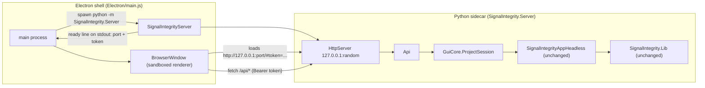

# SignalIntegrity desktop app (Electron)

A desktop window for SignalIntegrity built with [Electron](https://www.electronjs.org). Like the
Tauri app in [`Tauri/`](../Tauri/README.md), it starts the SignalIntegrity Python engine as a
sidecar process and shows its web GUI. The UI, the server and the `.si` files are the same.
Only the shell differs: Electron ships its own Chromium instead of using the system WebView.

| GUI | Start with | Notes |
|---|---|---|
| tk (original, full featured) | `SignalIntegrity` | unchanged |
| Web | `SignalIntegrityServer --browser` | any browser |
| Tauri | `npm run tauri dev` in `Tauri/` | system WebView, small installer |
| Electron (this PR) | `npm start` in `Electron/` | bundled Chromium, same rendering on every OS |

## Architecture



Start-up sequence, the same as the Tauri shell:

1. The window opens on the bundled loading page (`loading/`).
2. `main.js` looks for Python: `$SIGNALINTEGRITY_PYTHON`, then the checkout's `.venv`, then
   `python`, `python3` and (on Windows) `py -3`. It runs
   `python -m SignalIntegrity.Server --exit-with-stdin [project.si]` with no console window.
3. The server binds a random port on `127.0.0.1`, makes a random token and prints one JSON
   ready line. The shell accepts only an `http://127.0.0.1` URL.
4. The window loads `http://127.0.0.1:<port>/?skin=vscode&titlebar=custom#token=<token>`.
   From then on the UI talks only to the token-protected JSON API (see
   [`SignalIntegrity/Server/README.md`](../SignalIntegrity/Server/README.md)).
5. On quit the shell closes the sidecar's stdin and kills it. Because the shell holds that
   pipe, the sidecar also stops by itself if Electron is killed or crashes.

If no interpreter works, the loading page lists every one it tried and why it failed.

When run from a checkout, `main.js` puts the repository root (`Electron/..`, or
`$SIGNALINTEGRITY_ROOT`) on `PYTHONPATH` and starts the server there, so it runs your
working tree. A packaged app has no checkout and uses whatever `SignalIntegrity` the chosen
interpreter imports (`pip install SignalIntegrity`, or set `SIGNALINTEGRITY_PYTHON`).

The project to open comes from the command line (`electron . path/to/file.si`, or
`SignalIntegrity.exe file.si` when packaged; `.si` files are associated by the installer) or,
on macOS, from the `open-file` event.

## Look and feel

The Electron app uses the web UI's VS Code skin (see the Server README):

- **Title bar.** The window is frameless (`titleBarStyle: 'hidden'`). The menus sit in the
  title bar with the project name centred, and Electron draws the minimize, maximize and close
  buttons (`titleBarOverlay`; traffic lights on macOS). The UI publishes its toolbar colour as
  `<meta name="theme-color">`. The shell picks it up through `did-change-theme-color` and
  tints the window controls to match, so it needs no preload script or IPC.
- **Rounded panels with clear separators.** The side bars, the panel and the schematic are
  rounded cards on a slightly darker workbench, with visible gaps (the sashes). Pane headers
  are divided by lines, and the toolbar groups by vertical rules. Menus, dialogs, buttons and
  inputs have rounded corners too.
- **Line icons.** The toolbar and menus use single-colour line icons in the style of
  codicons (`ui/lineicons.js`); they take the theme's foreground colour. The toolbar shows
  icons only, with the name and shortcut in the tooltip, as VS Code does.
- **Pane controls.** Hover over a pane header for **Move to New Window** and **Close**.
  A pane in its own window is a real OS window that you can put on another monitor. Closing
  it docks the pane again. **View > Panels** shows closed panes again.

## Security

The page is a normal web page served by the local server, so the shell gives it no extra
power. There is no preload script and no IPC.

| Measure | Where |
|---|---|
| `contextIsolation: true`, `nodeIntegration: false`, `sandbox: true`, `webSecurity: true` | `BrowserWindow` options |
| Navigation and redirects are refused unless they go to the loading page or the server's own origin | `will-navigate`, `will-redirect` (every web contents, through `guard`) |
| The only new windows are pane windows: `about:blank`, named `si-pane-<id>`, opened by the main window, with the same `webPreferences`. Everything else is denied; external `http(s)` links open in the default browser | `setWindowOpenHandler` |
| No `<webview>` tags | `will-attach-webview` |
| All permission requests (camera, notifications, ...) denied | `setPermissionRequestHandler`, `setPermissionCheckHandler` |
| The loading page has its own CSP (`default-src 'none'; script-src 'self'`) | `loading/index.html` |
| Token in the URL fragment, Host/Origin checks, CSP on the UI | the server (unchanged) |
| A fresh token every start; `SIGNALINTEGRITY_SERVER_TOKEN` is removed from the sidecar's environment | `startCandidate` |

Help opens in the system browser through the server's `help` API, so the window never needs
to show anything else.

`npm audit` reports advisories (glob ReDoS in `minimatch`/`picomatch` and similar) in
electron-builder's dependency tree. They are build-time tools only and are not in the
packaged app, which contains just `main.js`, `loading/` and `icons/` on top of Electron.

## Running and building

Prerequisites: Node.js 18+ and a Python with SignalIntegrity's requirements (the checkout's
`.venv` is used automatically).

```bash
cd Electron
npm install          # electron and electron-builder (dev dependencies)
npm start            # run the app on this checkout
npm start -- ../SignalIntegrity/App/Examples/RLC.si
npm run smoke        # headless check, see below
npm run dist         # installers in Electron/dist (NSIS on Windows, AppImage/deb on Linux, dmg on macOS)
npx electron-builder --dir   # unpacked app only, faster
```

In VS Code, use the Run and Debug configuration `SignalIntegrity: Desktop (Electron)`.

Behind a TLS-inspecting proxy, Node's built-in CA list may reject the Electron download
(`fetch failed`, `UNABLE_TO_GET_ISSUER_CERT_LOCALLY`). Set `NODE_USE_SYSTEM_CA=1` for the
install so Node trusts the operating system's certificate store. Don't disable TLS checks.

### Smoke test

`electron . --smoke-test [project.si]` (`npm run smoke`) runs the real shell with a hidden
window. It waits for the toolbar, the menus and, if a project is given, the drawn schematic.
It then checks that:

- the page can't see Node (`require` and `process` are undefined);
- the VS Code skin is on and every toolbar button has a line icon;
- Device Properties moves to a window of its own, docks again when that window is closed,
  and closes with its Close button;
- navigating to another origin is blocked.

It uses a temporary settings folder, so it never changes your saved layout. It prints one JSON
line and exits with 0 or 1:

```json
{"ok":true,"nodeInPage":"undefined/undefined","navigationBlocked":true,"panes":{"before":"docked","poppedOut":"window","paneWindows":1,"paneWindowTitle":"Device Properties - SignalIntegrity","afterWindowClosed":"docked","afterClose":"closed","ok":true},"title":"SignalIntegrity - RLC.si","toolbarButtons":21,"menus":8,"drawn":46,"skin":true,"lineIcons":21,"origin":"http://127.0.0.1:54267"}
```

Start-up failures print `{"ok":false,"error":"..."}` and exit 1, so the same command works
in CI.

## Icon

`icons/icon.png` (1024 px) and `icons/icon.ico` are rendered by `Tauri/MakeIcons.py`:
`python Tauri/MakeIcons.py Electron/icons electron` (needs Pillow and numpy). The Electron
icon is the same eye diagram on a midnight-navy tile with an electric-blue trace, so it is
easy to tell apart from the Tauri (violet) and Qt (teal) icons.

## Files

- `main.js`: the main process (Python search, sidecar, window, security, smoke test).
- `loading/`: page shown while the engine starts, and `showStartupError`.
- `icons/`: app icons.
- `package.json`: scripts and the electron-builder configuration (`build`).

## Validation

Tested on Windows 11 with Electron 45.3.3, electron-builder 26.18.0 and Python 3.14:

- `npm run smoke` with no project and with `RLC.si`: `ok:true`, 21 toolbar buttons (all line
  icons), 8 menus, 46 schematic elements, no Node in the page, navigation blocked, and the
  Device Properties pane round trip (window titled `Device Properties - SignalIntegrity`,
  docked again when that window closes, then closed).
- In a browser with `?skin=vscode`: the light and Dark Modern themes; pane buttons on hover;
  Variables moved to a window, docked again, closed and shown again from View > Panels;
  Device Properties in its own window updating live when a part is selected in the main
  window.
- No usable Python (`SIGNALINTEGRITY_PYTHON` pointing nowhere, empty `PATH`): the error lists
  all four candidates; exit code 1.
- Normal launch with `RLC.si`: window title `SignalIntegrity - RLC.si`; closing the window
  stops the sidecar.
- Electron force-killed: the sidecar exits by itself (`--exit-with-stdin`).
- `npx electron-builder --dir --win`: the packaged `SignalIntegrity.exe` passes the smoke test
  with `RLC.si`.
- The Python test suites pass: GuiCore and Server (75), and in the Qt worktree GuiCore and
  QtApp (78) with the shared `GuiCore/Menus.py` change.
