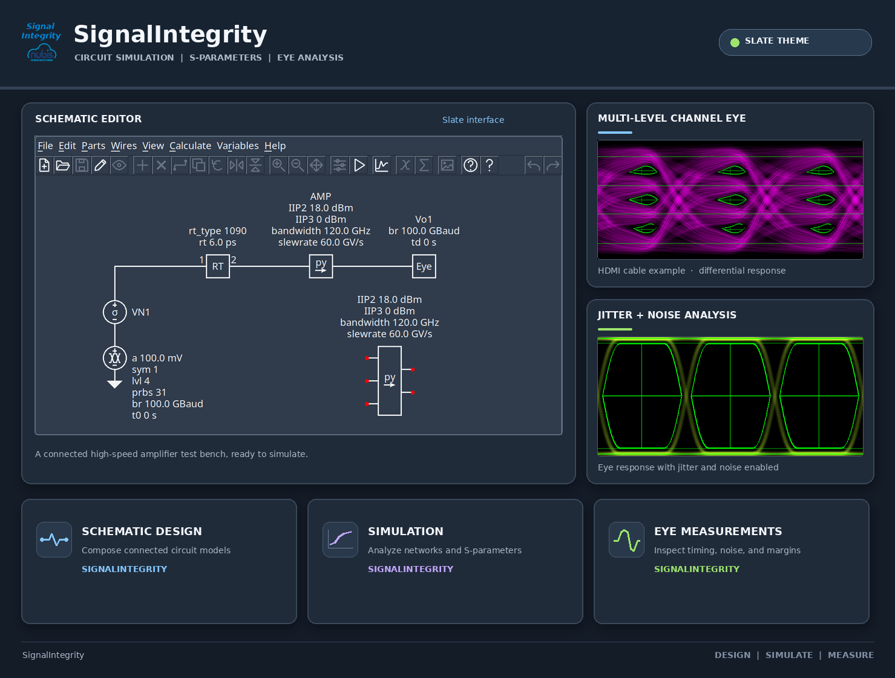

# SignalIntegrity: Signal and Power Integrity Tools

master: 
InNextRelease: 

[Go to the official website for these tools](https://github.com/Nubis-Communications/SignalIntegrity/wiki)

[Go to Ciena's website](https://www.ciena.com/)

***
[Download the latest release](https://github.com/Nubis-Communications/SignalIntegrity/releases)
***

