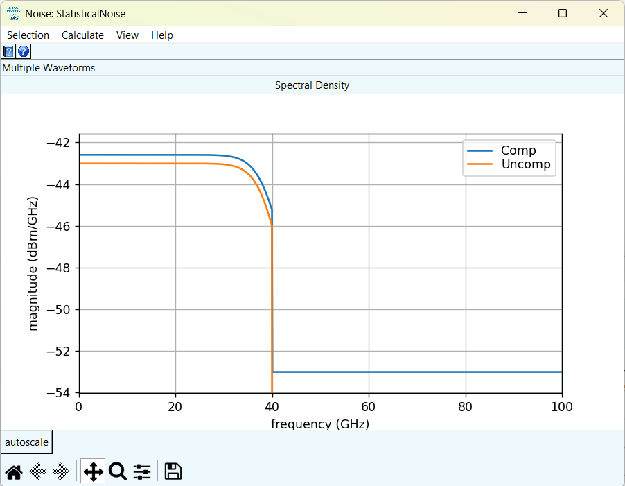
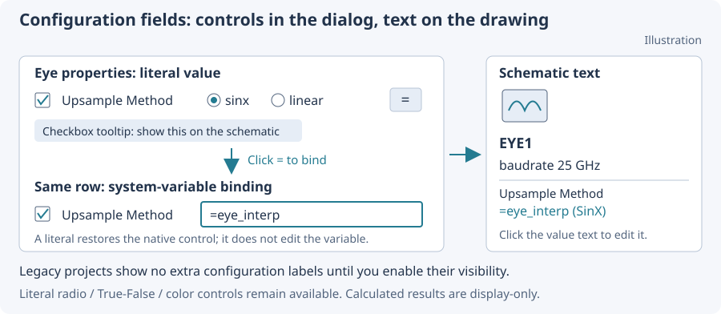
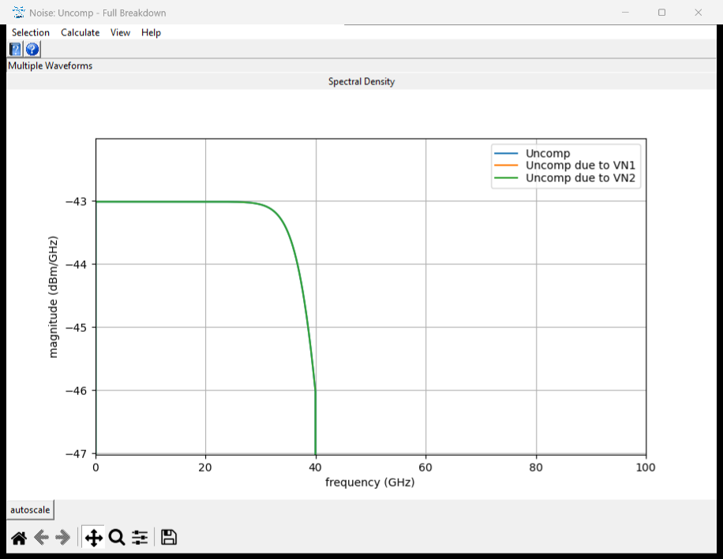
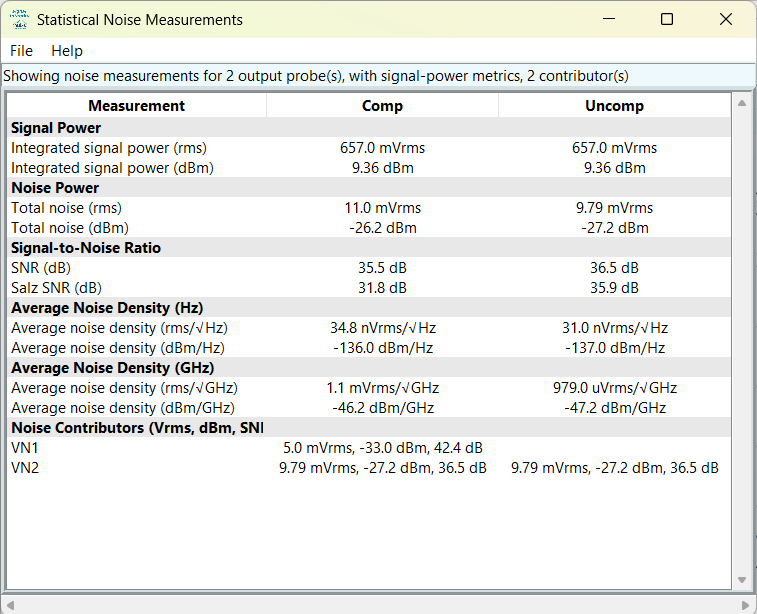

# Statistical Noise Dialog {#sec:Statistical-Noise-Dialog}

<div class="center">



</div>

The statistical noise dialog displays the output noise spectral densities computed by a [Statistical Noise Analysis](31-Statistical-Noise-Dialog.md#sub:Statistical-Noise-Analysis). It appears under the following conditions:

- Automatically after [Simulating](08-Simulation.md#sub:Simulating) completes in a [Simulation](08-Simulation.md#sec:Simulation) application when the schematic contains at least one enabled statistical noise source (see the [Voltage Statistical Noise Source](23-Built-in-Devices-Parts.md#device:Voltage-StatisticaL-Noise-Source) and [Current Statistical Noise Source](23-Built-in-Devices-Parts.md#device:Current-StatisticaL-Noise-Source)) and at least one output probe designated to be included in the noise.

- When viewing the noise contribution of a statistical noise source through the [Edit Properties](15-Main-Schematic-Dialog.md#Control-Help:Edit-Properties) command.

Statistical noise is an optional feature that must be enabled in the [Preferences](29-Preferences.md#sec:Preferences).

## Source configuration fields on the schematic

Open a voltage or current statistical noise source's configuration and select
the unlabeled checkboxes beside properties you want to see on the schematic, such as noise
type, noise density, bandwidth, lanes, or a spectral-density filename. Only
properties applicable to the selected model are shown; inactive properties retain
their checked state. Hover over a checkbox for its visibility tooltip. Visible
configuration fields appear below the normal device properties and variables,
keeping the reference designator above them.



Click a displayed property to edit it directly, using a literal or
`=system_variable_name`. The label shows a binding and its resolved value.
The configuration dialogs retain their grouped radio buttons, True/False buttons,
and file controls. Click **=** beside a control to enter a system-variable binding;
only bound properties replace their native control with a text entry. Hover over
a control for descriptions and exact enum keywords.
Invalid entries retain the editor and show an error; a missing or
invalid active system-variable binding must be corrected before calculation.
Entering a literal detaches only that field's binding, leaving the variable
unchanged. Time-varying shot noise's calculated mean current is display-only;
its original input binding is retained for returning to Mean mode.

Spectral-density file entries include a **Browse** button with `.txt`, `.csv`,
and `.json` filters. Browsing starts beside the current file, including when
its path comes from a system variable. Selecting a file saves a project-relative
literal path and replaces that field's binding; canceling changes nothing.
The file is included when archiving the project.

These settings are per device and survive save/reopen and undo. Existing projects
start with no additional configuration labels; open their configuration and
select a property's visibility checkbox to opt in. Saving global defaults stores resolved literals, not
project-specific variable bindings.

The main part of the dialog is a MatPlotLib plot (see <http://matplotlib.org>) with control of panning and zooming. The plot shows the output noise spectral density in dBm/Hz (or dBm per displayed frequency unit) on the y axis versus frequency on the x axis, with a legend in the upper right naming each displayed output probe. The **autoscale** button below the plot returns to the automatic scaling of the axes.

This dialog has a menu and toolbar with commands that handle:

- [Statistical Noise File Menu](31-Statistical-Noise-Dialog.md#sub:Statistical-Noise-File-Menu)

- [Statistical Noise Selection Menu](31-Statistical-Noise-Dialog.md#sub:Statistical-Noise-Selection-Menu)

- [Statistical Noise Calculate Menu](31-Statistical-Noise-Dialog.md#sub:Statistical-Noise-Calculate-Menu)

- [Statistical Noise View Menu](31-Statistical-Noise-Dialog.md#sub:Statistical-Noise-View-Menu)

- [Statistical Noise Help Menu](31-Statistical-Noise-Dialog.md#sub:Statistical-Noise-Help-Menu)

Along with context sensitive help.

## Statistical Noise Analysis {#sub:Statistical-Noise-Analysis}

A statistical noise analysis propagates the noise generated by each statistical noise source in the schematic to every output probe. During [Simulation](08-Simulation.md#sec:Simulation), the transfer matrices relating each source to each output are computed. The spectral density produced by each noise source is multiplied by the corresponding transfer matrix and the contributions are combined (as uncorrelated power) at each output probe to produce the total output noise spectral density.

Statistical noise sources come in both voltage and current forms (see the [Voltage Statistical Noise Source](23-Built-in-Devices-Parts.md#device:Voltage-StatisticaL-Noise-Source) and [Current Statistical Noise Source](23-Built-in-Devices-Parts.md#device:Current-StatisticaL-Noise-Source)), and each is available as a one-port, two-port, differential, and common-mode element. In addition to the differential source, which injects its noise differentially between the two conductors of a differential pair, there is a common-mode version that injects the same noise onto both conductors relative to ground. Both the differential and common-mode variants are propagated to the output probes in the same manner.

Each output probe reports its noise in units appropriate to the quantity it measures: a current output probe reports its noise in current units ($\mathrm{A_{rms}}$, $\mathrm{A_{rms}}/\sqrt{\mathrm{Hz}}$), while every other probe reports voltage units ($\mathrm{V_{rms}}$, $\mathrm{V_{rms}}/\sqrt{\mathrm{Hz}}$).

The probe property *include in noise measurements* has three choices:

| Choice | Effect |
|:---|:---|
| no | Omits the probe from the statistical noise plots and measurements. |
| yes | Includes the probe's total output noise spectrum in the main dialog and its results in the [Noise Measurements](31-Statistical-Noise-Dialog.md#Control-Help:Noise-Measurements). |
| full breakdown | Includes the probe just as *yes* does, and also opens a separate [Full Breakdown](31-Statistical-Noise-Dialog.md#sub:Statistical-Noise-Full-Breakdown) dialog for that probe. |

The default is *yes*. Existing projects containing *on* or *off* values remain supported; these are interpreted as *yes* or *no*, respectively. Eye probes set to *no* remain part of the underlying results (so their external noise is still applied to the eye diagrams) but are omitted from the statistical noise plots and measurements.

For each eye probe, the total integrated output noise (the rms noise reported in the [Noise Measurements](31-Statistical-Noise-Dialog.md#Control-Help:Noise-Measurements)) is placed into the read-only [External Noise](22-Eye-Diagram-Properties.md#sub:Noise) box of that eye's [Eye Diagram Properties](21-Eye-Diagram-Properties-Dialog.md#sec:Eye-Diagram-Properties-Dialog). There it is root-sum-squared with the user-entered [Inherent Noise](22-Eye-Diagram-Properties.md#sub:Noise) to form the total vertical noise applied to the eye diagram (i.e. $\sqrt{\mathrm{Inherent\ Noise}^{2}+\mathrm{External\ Noise}^{2}}$). In this way the noise computed by the statistical noise analysis is automatically added to the eye diagrams.

## Full Breakdown {#sub:Statistical-Noise-Full-Breakdown}

<div class="center">



</div>

For every probe whose *include in noise measurements* property is set to *full breakdown*, simulation opens an additional dialog titled **Noise: &lt;probe&gt; - Full Breakdown**. The probe also remains in the main statistical noise dialog and measurements, exactly as with *yes*.

The breakdown plot contains the probe's total output noise spectrum, labelled with the probe reference, and one spectrum for each statistical noise source, labelled **&lt;probe&gt; due to &lt;source&gt;**. Each source trace is its contribution **at this probe**, after propagation through the circuit, not the spectrum injected at the source. These contributions combine as uncorrelated noise power to produce the total spectrum.

Use the **Selection** menu to show or hide the total and individual source traces independently. The plotting, autoscale, and **Noise Measurements** controls are available as in the main dialog. **View Transfer Parameters** is disabled in the breakdown dialog; use the main noise dialog to inspect those parameters. Recalculating refreshes the breakdown windows and closes any whose probes no longer request *full breakdown*.

Selecting *full breakdown* changes only the graphical presentation. Compared with *yes*, it does not change the noise calculations, the noise applied to eye diagrams, or the measurements dictionary returned by headless calls.

## Statistical Noise File Menu {#sub:Statistical-Noise-File-Menu}

### Save Noise Spectral Densities {#Control-Help:Save-Noise-Spectral-Densities}

**File > Save Noise Spectral Densities**, also available from the toolbar, prompts for a file for each selected trace. The default `.txt` files contain frequency-domain amplitude spectral density, not the plotted dB values. Voltage traces are in V/√Hz and current traces are in A/√Hz. A file can be selected as the **Spectral Density File** of a corresponding voltage or current statistical noise source. The same command is available in full breakdown windows for their selected traces.

The first save starts in the project folder. Subsequent saves start in the folder chosen for the preceding saved trace.
In the themed save dialog, **New Folder** creates and opens a folder in the current directory.

### Spectral-Density File Formats {#sub:Noise-Spectral-Density-Files}

The **Spectral Density File** noise model accepts native `.txt` files, `.csv`
files, and `.json` data. These contain amplitude spectral density, not plotted
dBm/Hz values: use V/sqrt(Hz) for a voltage source and A/sqrt(Hz) for a current
source, with frequency in Hz.

CSV files use frequency and amplitude density in two columns. JSON accepts
frequency/density arrays directly at the root:

```json
{"x": [0, 1000000000, 2000000000], "y": [1e-9, 1e-9, 5e-10]}
```

The same arrays may be wrapped in a `noise` or `wave` object:

```json
{
  "description": "Example voltage noise, V/sqrt(Hz)",
  "noise": {"x": [0, 1000000000, 2000000000], "y": [1e-9, 1e-9, 5e-10]}
}
```

The reader uses `noise` first, then `wave`, then root-level `x`/`y`; wrapped data
takes precedence if several forms are present. Within a wrapper, the pairs
`frequency`/`density` and `frequencies`/`densities` are also accepted. Additional
metadata is ignored. The frequency and density arrays must be nonempty, have the
same length, and contain finite numeric values.

## Statistical Noise Selection Menu {#sub:Statistical-Noise-Selection-Menu}

The selection menu shows the selection tasks along with a list of all displayed
output probes. Clicking an output toggles its display. On Tk versions that
provide a dotted tear-off entry, that entry can detach the menu; Tk 9 has no
tear-off entry by default. Trace selection works in either case. The selection tasks are:

- [Display All](14-Simulator-Dialog.md#Control-Help:Display-All) - selects all noise traces for displaying.

- [Display None](14-Simulator-Dialog.md#Control-Help:Display-None) - turns off display of all noise traces.

- [Toggle All](14-Simulator-Dialog.md#Control-Help:Toggle-Selections) - toggles all display states.

In a full breakdown dialog, the selection menu lists the probe total and each source contribution. The selection menu is disabled when there is only one available trace.

## Statistical Noise Calculate Menu {#sub:Statistical-Noise-Calculate-Menu}

The Calculate tasks are:

- [Calculation Properties](15-Main-Schematic-Dialog.md#Control-Help:Calculation-Properties)

- [View Transfer Parameters](14-Simulator-Dialog.md#Control-Help:View-Transfer-Parameters) - views the noise transfer parameters relating each noise source to each output probe in the [S-parameter Viewer](13-S-parameter-Viewer.md#sec:S-parameter-Viewer).

- [Recalculate](14-Simulator-Dialog.md#Control-Help:Recalculate)

## Statistical Noise View Menu {#sub:Statistical-Noise-View-Menu}

The View tasks control the appearance of the spectral density plot and open the measurements table:

- [Show Grids](14-Simulator-Dialog.md#Control-Help:Show-Grids-1) - toggles the display of grids on the plot.

- [Log Frequency Scale](14-Simulator-Dialog.md#Control-Help:Sim-Log-Scale) - sets the frequency axis to a log scale.

- [Noise Measurements](31-Statistical-Noise-Dialog.md#Control-Help:Noise-Measurements)

### Noise Measurements {#Control-Help:Noise-Measurements}

|    *Dialog*    | [Statistical Noise Dialog](31-Statistical-Noise-Dialog.md#sec:Statistical-Noise-Dialog) |
|:--------------:|:----------------------------------:|
| *Menu System*  |        View Noise Measurements        |
|  *Navigation*  |              Alt+V,N               |
| *Key Binding*  |                None                |
|   *Toolbar*    |                None                |
| *Availability* | When there is at least one displayed output probe |

Opens the [Statistical Noise Measurements](31-Statistical-Noise-Dialog.md#sub:Statistical-Noise-Measurements) dialog, a table summarizing the integrated signal power, noise power, signal-to-noise ratio, average noise density, and per-source noise contributions for each displayed output probe.

## Statistical Noise Measurements {#sub:Statistical-Noise-Measurements}

<div class="center">



</div>

The statistical noise measurements dialog presents the noise results in a column-oriented table, one column per displayed output probe. The rows are organized into the following groups:

| Group | Rows |
|:---|:---|
| Signal Power | Integrated signal power (rms) and (dBm) |
| Noise Power | Total noise (rms) and (dBm) |
| Signal-to-Noise Ratio | SNR (dB) and Salz SNR (dB) |
| Average Noise Density (Hz) | Average noise density in rms/$\sqrt{\mathrm{Hz}}$ and dBm/Hz |
| Average Noise Density (GHz) | Average noise density in rms/$\sqrt{\mathrm{GHz}}$ and dBm/GHz |
| Noise Contributors | One row per noise source, each reporting rms, dBm, and SNR (dB) of that source's contribution to the output |

The rms rows report voltage units ($\mathrm{V_{rms}}$) for voltage probes and current units ($\mathrm{A_{rms}}$) for current probes. Values whose magnitude is below the [ZeroThreshold](29-Preferences.md#sub:StatisticalNoise.ZeroThreshold) preference are left blank, and signal-to-noise ratios above the [MaximumSNR](29-Preferences.md#sub:StatisticalNoise.MaximumSNR) preference (which indicate essentially zero noise) are also left blank.

The measurements dialog has its own File and Help menus:

### Save to CSV {#Control-Help:Statistical-Noise-Save-CSV}

|    *Dialog*    | [Statistical Noise Measurements](31-Statistical-Noise-Dialog.md#sub:Statistical-Noise-Measurements) |
|:--------------:|:----------------------------------:|
| *Menu System*  |          File Save to CSV          |
|  *Navigation*  |              Alt+F,S               |
| *Key Binding*  |                None                |
|   *Toolbar*    |                None                |
| *Availability* |               Always               |

Saves the measurements table to a comma-separated-value (`.csv`) file, with one row per measurement and one column per output probe.

### Preferences {#Control-Help:Statistical-Noise-Preferences}

|    *Dialog*    | [Statistical Noise Measurements](31-Statistical-Noise-Dialog.md#sub:Statistical-Noise-Measurements) |
|:--------------:|:----------------------------------:|
| *Menu System*  |          Help Preferences          |
|  *Navigation*  |              Alt+H,P               |
| *Key Binding*  |                None                |
|   *Toolbar*    |                None                |
| *Availability* |               Always               |

Edits the [Statistical Noise Preferences](29-Preferences.md#sub:Statistical-Noise-Preferences), which control the display thresholds used to blank near-zero noise values and unphysically high signal-to-noise ratios in the measurements table.

## Statistical Noise Help Menu {#sub:Statistical-Noise-Help-Menu}

The Help tasks deal with the help system:

- [Open Help File](31-Statistical-Noise-Dialog.md#Control-Help:Statistical-Noise-Open-Help-File) - opens the help system to the [Statistical Noise Dialog](31-Statistical-Noise-Dialog.md#sec:Statistical-Noise-Dialog) page.

- [Control Help](31-Statistical-Noise-Dialog.md#Control-Help:Statistical-Noise-Control-Help) - for help on any menu element or toolbar button.

### Open Help File {#Control-Help:Statistical-Noise-Open-Help-File}

|    *Dialog*    | [Statistical Noise Dialog](31-Statistical-Noise-Dialog.md#sec:Statistical-Noise-Dialog) |
|:--------------:|:----------------------------------:|
| *Menu System*  |          Help Open Help File          |
|  *Navigation*  |              Alt+H,O               |
| *Key Binding*  |                None                |
|   *Toolbar*    |  |
| *Availability* |               Always               |

Opens the help system in a browser to the [Statistical Noise Dialog](31-Statistical-Noise-Dialog.md#sec:Statistical-Noise-Dialog) page.

### Control Help {#Control-Help:Statistical-Noise-Control-Help}

|    *Dialog*    | [Statistical Noise Dialog](31-Statistical-Noise-Dialog.md#sec:Statistical-Noise-Dialog) |
|:--------------:|:----------------------------------:|
| *Menu System*  |          Help Control Help          |
|  *Navigation*  |              Alt+H,C               |
| *Key Binding*  |                None                |
|   *Toolbar*    |  |
| *Availability* |               Always               |

Provides context-sensitive help on a control. Select this and then click on a control in the dialog to open the help for that control. Press Escape to cancel.
