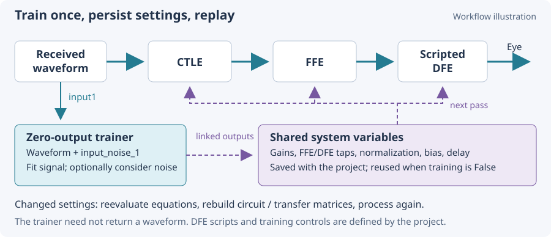

# Waveform Processors {#sec:Waveform-Processors}

A waveform processor is a simulation device that transforms measured circuit
waveforms and uses the transformed waveforms as sources on subsequent processing
iterations. It is an application-level device, not a standalone component in
`SignalIntegrity.Lib`.

## Add a Processor

Choose **Waveform Processor** from the Add Part picker for a new processor with
one input and one output. Use **Waveform Processor Python Script** to choose a
`.py` file and create a processor whose ports and variables are declared in that
script's interface block. In either case, the script text is embedded in the
project; the project does not depend on the selected script file remaining at
its original path.

The processor symbol places input pins down its left side and output pins down
its right side. There must be at least one input; the output count can be zero.
Changing counts preserves the
device's position and orientation.

The **element state** property follows the S-parameter-device rules:

- Leave it empty for normal script processing.
- `disabled` removes the device from the circuit and skips its script, noise
  inputs, and output-variable updates. The symbol is shown in salmon.
- `thru` replaces it with a passive ideal thru; `thru_wires` replaces it with
  wires and shows the bypass symbol in salmon. Neither runs the script.

Thru conversion requires an even total port count, as for S-parameter devices.
It pairs the first half of the numbered ports with the second half, preserving
their schematic locations. With an odd total (including a one-input,
zero-output trainer), thru conversion is ignored and processing remains active;
use `disabled` to turn that processor off. The state is stored in the project.

## Script Editor

Open the device properties and choose **Edit Script**, or right-click a writable
processor in the schematic and choose **Edit Script**. The editor's **File** menu
has two commands:

- **Import…** replaces the editor contents with a Python file. This only changes
  the script text in the current properties dialog.
- **Save As…** writes the current editor contents to a `.py` file. The processor
  continues to store the script in the project; Save As does not link the device
  to the exported file.

The **Debug** menu can execute the script with example input waveforms or run it
automatically as it is edited. When the editor is opened from device properties,
changes are committed to the schematic when **OK** is pressed and discarded when
**Cancel** is pressed.

## Script Interface

The simulator supplies sampled input waveforms in pin order as
`input_waveform_1`, `input_waveform_2`, and so on. The generated probe labels,
such as `WFP1_in1`, are also available as local variables. Device variables are
available by name; `int` and `float` values are passed as numbers, while `string`,
`enum`, and `file` values are passed as strings. A value beginning with `=` is
resolved from the schematic variables. `iteration` is the zero-based index of
the waveform pass that has just completed; a device variable named
`iteration` overrides it.

Assign every processor output using `output_waveform_1`, `output_waveform_2`,
and so on. Values should be `Waveform` objects or compatible results from
waveform operations. For example, a two-input, two-output processor might use:

```python
output_waveform_1 = (input_waveform_1 - input_waveform_2) * gain
output_waveform_2 = input_waveform_1 * gain
```

The script is evaluated once per processor on each iteration, returning all its
waveforms and output variables together. Assign all declared waveform outputs on
every run.

Processor input ordering follows the device's pin numbers, including processors
on other schematic pages. Internal source and noise ordering are preserved when
system-variable feedback rebuilds the circuit.

A processor with zero output ports still executes once per processing iteration.
It can analyze its input waveforms and noise spectra and update persistent output
variables without assigning any `output_waveform_*` values. No source or visible
waveform is generated. Such a processor also permits simulation without a separate
output probe. Script-editor previews execute it without displaying a waveform.

### Persistent Output Variables

Mark a device variable as **Output Variable** in the variable editor, or set
`"read_only": true` in its interface metadata, to use it as persistent script
state. Its current value is passed into the script like any other device
variable. After a successful execution, the returned value is stored back in
that device variable and supplied to the next iteration. Changes to input-only
variables inside the script are not stored.

Despite the legacy metadata name `read_only`, output variables can be edited in
the variables table and on the schematic. A subsequent script execution can
overwrite an edited value.

For example, define `dfe_tap` as a float output variable initially set to `0`,
and `optimize` as an integer input variable:

```python
if optimize:
    dfe_tap = 0.1  # Use the adaptation result here.
output_waveform_1 = input_waveform_1 - dfe_tap
```

The next execution receives `dfe_tap == 0.1`. Normal project **Save** stores the
updated value in the project file. Simulation does not automatically save the
project to disk. Set `optimize` to `0` to reuse the saved setting without
recalculating it; output variables may be left unchanged by the script.

Returned numeric values must match the declared interface and destination types;
fractional integer outputs are rejected. For coefficient lists, use a string
variable, store
`repr(list_of_taps)`, and read it with `ast.literal_eval`. If an output variable
contains `=system_variable`, the resolved system-variable value is passed in,
and the returned value updates that system variable. The device's reference is
preserved for subsequent iterations and project saves. For example, an output
named `X` set to `=Y` receives `0.3` when system variable `Y` is `0.3`. Returning
`X = 0.4` updates `Y` to `0.4`; the schematic displays `X=Y (0.4)`. Normal project
Save stores both the reference and `Y`'s updated value.

After each processor pass, the simulator compares hashes of the system-variable
values before and after script execution. A change reruns the system equations,
regenerates device/source definitions and transfer matrices, and adds one waveform
processing iteration. Existing processor output waveforms and learned variables
are preserved across this rebuild. Unchanged values, including equivalent numeric
spellings such as `1` and `1.0`, and changes to unlinked device output variables do
not trigger a rebuild.

The **Maximum Processing Iterations** preference limits these extra iterations,
even when **Stop On Convergence** is off. Waveform convergence cannot stop a pass
whose system variables changed. If they still change at the limit, simulation
fails rather than returning waveforms from an outdated system definition.
These preferences are described in
[Waveform Processing Iterations](29-Preferences.md#sub:Waveform-Processing-Iterations).

Script errors, missing outputs, and invalid numeric output variables leave that
execution's saved values unchanged. Script-editor debug runs and automatic
previews use copied device and system variables and do not modify saved state.

### Input Noise Spectra

Each input also receives an independent `SpectralDensity` object as
`input_noise_1`, `input_noise_2`, and so on. `Values()` gives amplitude density
in V/sqrt(Hz), `Frequencies()` gives Hz, and `TotalRMS()` gives integrated volts.
The simulator calculates these spectra before the processor scripts on each
iteration, using the current waveforms and the simulation calculation frequency
grid. Inputs without noise receive a zero spectrum, not `None`. Editor previews
use zero spectra on their example waveforms' frequency grid.

Scripts run with Python `exec` and are not sandboxed. The active project folder
is added to Python's import path, so a script can import a trusted helper module
stored beside the project. Only run scripts you trust.

## Equalizer Training and Replay {#sub:Scripted-Equalizer-Training}

Waveform processors can implement blind PAM equalizer training without a known
transmitted pattern. A useful arrangement is a zero-output trainer that observes
the received waveform and writes settings into shared system variables, followed
by ordinary circuit CTLE/FFE devices and a scripted DFE.



The repository's `Test/TestSignalIntegrity/TestEqualizer/TestEqualizer.si`
illustrates both a combined equalizer processor and a separate trainer/CTLE/FFE/
DFE chain. The scripts are embedded in that example project; **DFE is not a
separate built-in part in the Add Part palette**. Create a scripted processor or
import an appropriate script interface when using this arrangement.

The example's controls include:

| Variable | Meaning |
|:---|:---|
| `train_equalizer` | `True` learns settings; `False` applies the supplied settings without optimization. |
| `consider_noise` | Includes the filtered input noise in the fitting objective when `True`. Turning it off uses signal error alone. |
| `GDC_choices`, `GDC2_choices` | Python lists of CTLE gain candidates in dB. Candidate combinations are compared on held-out validation data. |
| `num_ffe_taps`, `num_precursor_taps`, `num_dfe_taps` | Training tap counts and FFE precursor placement. |
| `max_dfe_tap` | Bound on the magnitude of learned DFE coefficients, not a replacement for the saved coefficients in replay mode. |
| `*_input`, `*_output` | Supplied and learned gains, tap lists, normalization, bias, and sampling delay. Link outputs to system variables using `=name`. |

Use **Output Variable** for learned settings and normal project Save to persist
them. Change `train_equalizer` to `False` to reuse those settings. Normalization,
bias, and sampling delay are part of the learned state, not just the tap lists.
Updating linked system variables causes another waveform pass through the newly
configured circuit.

The example DFE consumes the waveform **after** the physical CTLE and FFE.
Its `ffe_taps_input` is used only to account for the upstream FFE's summed gain
in offset normalization; it does not apply another FFE. Its `train_sample_time`
option optimizes decision timing using the supplied DFE taps, without retraining
those taps. `sample_time_output` is the applied waveform delay in seconds,
normalized to one UI; feed it back into `sample_time_input` to replay that timing.

Training cost depends on the script, candidate count, tap count, and number of
symbols. A larger CTLE candidate grid requires more fits. To bound training cost,
a script can expose separate training and validation UI counts as interface
variables, keeping validation distinct from fitting. Such counts are
**script-defined**, not global simulator preferences: their names and defaults
must be declared by that script. **Maximum Processing Iterations** limits
waveform/feedback passes; it does not limit the symbols examined within a fit.

## Interface Metadata

The comment-delimited metadata block describes the processor interface. Each
line inside the block must remain a Python comment, so the script can be executed
normally:

```python
# <waveform-processor-interface>
# {
#   "version": 1,
#   "ports": {"inputs": 2, "outputs": 1},
#   "variables": [
#     {
#       "name": "gain",
#       "description": "Linear voltage gain",
#       "type": "float",
#       "default": 0.9,
#       "units": "V/V",
#       "visible": true,
#       "read_only": false,
#       "in_cache": true
#     }
#   ]
# }
# </waveform-processor-interface>
# Python script follows the metadata block.
output_waveform_1 = input_waveform_1 * gain
```

The block must occur once and declare `version` 1, a positive integer input count,
a nonnegative integer output count, and a `variables` list. Every variable requires `name`, `type`,
and `default`. Names must be unique Python identifiers. Supported types are
`int`, `float`, `string`, `enum`, and `file`. Optional fields are `description`,
`units`, `visible`, `read_only`, and `in_cache`. The default becomes the initial
value when a processor is created from the script.

## Import Variables

In the processor's **Variables** dialog, choose **Import from Script** to apply
the interface block in the current script. The application validates the full
block before changing anything, then updates the input and output port counts,
the device picture, and the variable definitions together. Invalid or missing
metadata leaves the device unchanged and reports an error.

When importing into an existing processor, definitions are refreshed by name.
The current value is preserved when a variable has the same name and type; new
variables receive their declared defaults. Variables no longer declared by the
script are removed only after confirmation. The port and variable changes are
part of the device-properties working copy: **OK** commits them to the schematic,
while **Cancel** discards them.

The **Waveform Processor Python Script** picker uses this same metadata parser
when creating a device from a `.py` file. A missing or invalid block prevents
creation, rather than creating a partially configured processor.

## Results And Linearization

When `show` is true, the processor's generated outputs appear in the simulation's
`other waveform labels` and `other waveforms` results, named `REF_out1`,
`REF_out2`, and so on. They are also available in the Simulator waveform plot.
They remain separate from circuit output probes and do not change transfer
matrices.

For transfer matrices and statistical-noise calculations, variable-port
processors are linearized as a unity-gain path from input 1 to output 1. Later
inputs and outputs are ignored in that view; the iterative waveform solver
still uses the full processor and all its ports.

Each processor stores its Python code in the project's `script` property.
`inputports` and `outputports` define the script interface.