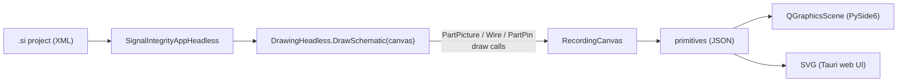
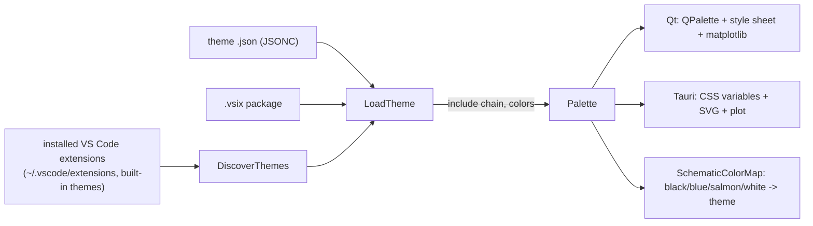

# GuiCore

`SignalIntegrity.GuiCore` is a small, toolkit-neutral layer used by the alternative user
interfaces (the PySide6 GUI in `SignalIntegrity/QtApp` and the Tauri GUI in
`SignalIntegrity/Server` + `Tauri/`). The tk application in `SignalIntegrity/App` does not
use it and is unchanged.

GuiCore only **adds** code. It does not change `SignalIntegrity.Lib`, `SignalIntegrity.App`,
or the `.si` project format. Scripts that use `SignalIntegrityAppHeadless`, `si.p.*` parsers,
`ProjectSParameters` and similar keep working exactly as before.

## Modules

| Module | Purpose |
|---|---|
| `RecordingCanvas.py` | Implements the six `tk.Canvas` calls the schematic code uses (`create_line`, `create_polygon`, `create_rectangle`, `create_oval`, `create_arc`, `create_text`) and records them as JSON-serializable dicts. |
| `Session.py` | `ProjectSession` is a façade over `SignalIntegrityAppHeadless`: it opens and saves projects, renders, selects and moves devices, edits properties, property visibility and variables, sets calculation properties, shows the netlist, runs calculations, and traverses the project hierarchy. |
| `Results.py` | `ResultData` keeps the original SignalIntegrity waveforms, s-parameters and eye-diagram images of a calculation or device view. It provides plot data (time, spectral content, spectral density) for any x range, with min/max decimation, and autoscale limits chosen the way the tk simulator dialog chooses them. |
| `Themes.py` | Finds and loads VS Code color themes (installed extensions, theme `.json` files and `.vsix` packages) and maps them to the palette both GUIs use. Stdlib only. |
| `Menus.py` | The menu bar (laid out like the tk app: File, Edit, Parts, Wires, View, Calculate, Help) and toolbar of both GUIs as data: command ids, labels, shortcuts, submenus, toolbar order and captions. |
| `Icons.py` | The toolbar and menu icons as 32x32 SVG, keyed by command id, drawn to read on light and dark themes. |
| `Settings.py` | The settings folder both GUIs share (`SIGNALINTEGRITY_GUI_SETTINGS` overrides it) and the recent-projects list. |

See [RECIPES.md](RECIPES.md) for how to extend the GUIs without touching more files than needed.

## How rendering works

The part pictures in `PartPicture.py` (about 2,900 lines of procedural drawing code) are reused
as-is. `DrawingHeadless` already accepts any object with the `tk.Canvas` drawing API (the TikZ
exporter works the same way), so each new GUI only needs to turn about 6 primitive types into
its own toolkit.

### Primitive format

| type | fields |
|---|---|
| `line` | `points` [x0,y0,x1,y1,...], `color`, `width`, optional `arrow` (`first`/`last`/`both`), `arrowshape` [d1,d2,d3], `dash` |
| `polygon` | `points`, `outline`, `fill` |
| `rectangle`, `oval` | `bbox` [x0,y0,x1,y1], `outline`, `fill` |
| `arc` | `bbox`, `start`, `extent` (degrees, counter-clockwise, like tk), `outline` |
| `text` | `x`, `y`, `text`, `anchor` (tk anchor: `n`, `sw`, `center`, ...), `color` |

Coordinates are in the same pixel units the tk application uses (`grid` pixels per grid unit).

## ProjectSession API

| Method | Returns |
|---|---|
| `Open(filename)` | render dict (below); raises `SessionError` on failure |
| `New(filename)` | starts an empty project and saves it to `filename`, as the tk **File > New Project** does; returns the render dict |
| `Save(filename=None)` | the saved path (`.si` is appended if missing) |
| `Render()` | `{filename,title,path,readOnly,canAscend,grid,items,bbox,devices,capabilities,equationsValid}` |
| `DeviceAt(x,y)` / `Select(index)` | device index under a pixel point / select one device |
| `DeviceProperties(index)` / `SetDeviceProperty(index,keyword,value)` | list of `{keyword,name,description,type,unit,value,visible,keywordVisible,validEntries,readOnly}`; enum values are checked against `validEntries` |
| `SetDevicePropertyVisibility(index,keyword,visible=None,keywordVisible=None)` | chooses what is shown next to the part on the schematic (the tk properties dialog checkboxes) |
| `MoveDevice(index,dx,dy)` / `RotateDevice(index)` | move by whole grid units / rotate 90° |
| `Variables()` / `SetVariable(name,value)` / `SetVariableVisible(name,visible)` | list of `{name,value,type,units,description,visible,readOnly}` |
| `CalculationProperties()` / `SetCalculationProperties(dict)` | `EndFrequency`, `FrequencyPoints`, `UserSampleRate`, `ReferenceImpedance` |
| `NetList()` | netlist text |
| `Calculate(kind, callback=None)` | `kind` is one of `simulate`, `sparameters`, `virtualprobe`, `deembed`; returns `ResultData` |
| `ViewActions(index)` | the device's tk **View** menu actions: `file` (View an s-parameter file / Open Project for a `.si` file), `openproject` (a source's waveform project), `waveform` (View Waveform) |
| `View(index,action)` | `('project',render)` after descending, or `('result',ResultData)` |
| `Descend(index,filename)` / `Ascend()` | enters a sub-project read-only, passing the device variables (plus calculation properties when `calcprop` is true) exactly like the tk app's `LaunchProjectFile`; returns to the parent with its unsaved edits |
| `PartCatalog(previews=False)` | every part in the tk **Add Part** picker (`DeviceList`, `DeviceListUnknown`, `DeviceListSystem`, enabled parts only) as `[{index,partname,description,categories,preview?}]`; `description` is unique and is the label the stencils show |
| `PartPreview(index)` | `{items,bbox}` primitives of a catalog part drawn at the origin, used for stencil thumbnails |
| `AddPart(index,x,y)` | places a copy of a catalog part with its origin on the grid point nearest pixel `x,y`, initialized from preferences, with a unique reference designator (`R1`, `R2`...) and, for ports, the next port number, as the tk app does; selects it and returns its device index |
| `DeleteDevice(index)` | removes a device |
| `Wires()` | `[{index,points,selected}]`, each wire's vertices as a flat pixel list; also in the render dict as `wires` |
| `AddWire(points)` | adds a wire through `[[x,y],...]` pixel points; each snaps to the nearest grid point, repeats are dropped, and the wires are consolidated (split at junctions and pins, joined where only two meet) as the tk app does |
| `WireAt(x,y,tolerance=None)` / `SelectWire(index)` / `DeleteWire(index)` | hit test (tolerance in pixels, default a quarter grid), select one wire (deselecting devices), delete one wire. `Select(index)` deselects wires. |
| `VertexAt(x,y,tolerance=None)` / `SelectVertex(wire,vertex)` | `(wire,vertex)` under a pixel point / select one wire vertex (`selectedVertex` in the render dict) |
| `MoveVertex(wire,vertex,x,y)` / `DeleteVertex(wire,vertex)` / `DuplicateVertex(wire,vertex)` | as the tk vertex commands: a moved vertex snaps to the grid and the wires are consolidated; a wire left with one vertex is removed; the duplicate is inserted after the original and selected so it can be dragged away |
| `FlipDevice(index,direction)` | mirror a part `'horizontal'`ly or `'vertical'`ly (the tk Orientation menu) |
| `Copy(index)` / `Cut(index)` / `Paste(x=None,y=None)` / `Duplicate(index,x,y)` | part clipboard; pasted and duplicated parts get a new reference designator and port number and are selected |
| `Undo()` / `Redo()` / `CanUndo()` / `CanRedo()` | up to `MAX_UNDO` (100) project snapshots; every edit above records one under its event name, which `Undo`/`Redo` return. The render dict has `canUndo`, `canRedo`, `undoName`, `redoName` and `canPaste`. |
| `Equations()` / `CheckEquations(text)` / `SetEquations(text)` | the schematic equations (tk **Variables > Equations**); check returns the first error or `None` |
| `PostProcessing()` / `SetPostProcessing(text)` | the post-processing script lines |
| `Archive()` / `ExtractArchive(filename)` | writes `<project>.siz` with every file the project uses (tk **File > Archive**) and returns its path / unpacks one into `<name>_Archive` and opens the project |
| `ExportNetList(filename)` / `ExportTikZ(filename)` / `ExportImage(filename,colorMap,background,scale)` | netlist `.txt`; TikZ (`.TpX` gives a TpX-wrapped file as the tk app writes); PNG or JPEG of the schematic drawn with PIL |

`AddPart`, `DeleteDevice`, `AddWire`, `DeleteWire` and the other edits raise `SessionError` at a read-only (traversed) level.

`Preferences.Items()` / `Preferences.Set(path,value)` list and change the tk preferences file
(`SIGNALINTEGRITY_PREFERENCES` overrides its location); `Help.Url(topic)` / `Help.Open(topic)`
open the online help for `introduction`, `equations`, `postprocessing`, `preferences` or
`documentation`.

### ResultData

| Member | Returns |
|---|---|
| `waveforms`, `sparameters`, `eyes` | `(name, Waveform or float)`, `(name, SParameters)`, `(name, PIL image)` lists |
| `WaveformInfo()` | `[{index,name,dc,points,start,sampleRate}]` |
| `Arrays(i,view)` | full-resolution numpy `(x,y)` for `time`, `content` (dBm) or `density` (dBm/Hz) |
| `Series(view,indices,xmin,xmax,maxPoints)` | JSON plot data limited to an x range; min/max decimation keeps every peak visible |
| `AutoscaleLimits(view,indices)` | `[xmin,xmax,ymin,ymax]` as the tk dialog computes them (spectral views clip the floor at mean-½σ) |
| `SParameterTime(index,view,maxPoints)` | impulse, step or impedance (`SPARAMETER_TIME_VIEWS`) responses of the diagonal and through terms, as the tk s-parameter viewer computes them; impedance is capped at `IMPEDANCE_LIMIT` |
| `NoiseInfo()` / `NoiseSeries(indices,maxPoints)` | statistical noise measurements per output (rms, dBm, densities, SNR, Salz SNR, per-source contributions) / output noise densities in dBm/Hz |
| `Summary()` | JSON description with waveform info, s-parameter traces, eye images as PNG data URLs and noise measurements |

The waveform list matches the tk simulator dialog: output probes, other waveforms, sources
with `show` on, and waveform-processor sources, each once.

Every calculation runs through the same `SignalIntegrityAppHeadless` methods (`Simulate`,
`CalculateSParameters`, `VirtualProbe`, `Deembed`) that scripts and the regression tests use,
so results are numerically identical to the tk GUI. `TestGuiCore.testSimulateMatchesHeadless`
checks this to 12 decimal places.

If the progress callback returns `False`, the calculation is cancelled and `Calculate` raises
`SessionError`.

## Themes

Both GUIs can be restyled with any VS Code color theme. `Themes.py` reads the standard VS Code
formats, so the themes on the VS Code Marketplace and Open VSX work without conversion.

| Function | Purpose |
|---|---|
| `DiscoverThemes(folders=None)` | the built-in **SignalIntegrity Light**/**Dark** themes, then every JSON color theme contributed by extensions in `VSCodeExtensionFolders()` (VS Code, Insiders, VSCodium, Cursor and Windsurf user extensions, plus the themes built into VS Code) as `[{id,label,uiTheme,extension}]` |
| `ThemesInPackage(path)` | the themes in one `.vsix` file or extension folder |
| `LoadTheme(id)` | `(name, palette)` for a built-in id, a theme `.json` path, an extension folder, a `.vsix` (its first theme), or a `package.vsix::extension/themes/x.json` id |
| `Palette(theme)` | maps workbench colors (`editor.background`, `sideBar.*`, `button.*`, `list.activeSelection*`, `statusBar.*`, `terminal.ansi*`...) to the GUI palette: window, panel, toolbar, input, selection and status bar colors, schematic ink/selection/background, and plot trace colors |
| `SchematicColorMap(palette)` | how the tk part-picture colors are recolored: `black` ink, `blue` selection, `salmon` disabled parts and `white` fills |
| `CurrentTheme()` / `SaveThemeId(id)` | the theme both GUIs use, stored in `gui-theme.json` under `%APPDATA%\SignalIntegrity` (`~/.config/SignalIntegrity` on Linux, `~/Library/Application Support/SignalIntegrity` on macOS); falls back to the light theme if the saved theme is gone |

Theme files are JSON with comments and trailing commas (JSONC); `include` chains are followed
as VS Code does. TextMate `.tmTheme` themes and token colors are ignored, since the GUIs only
need workbench colors. The palette keeps the schematic readable: if a theme's link color is
too close to its background, a standard blue is used for the selection, and plot traces fall
back to a built-in set when a theme has fewer than four distinct ANSI colors with enough
contrast.

## Limits

- `ProjectSession` uses the process-global `SignalIntegrity.App.Project`, the same as the
  headless app. Use one session per process (or per worker process).
- Opening a project changes the working directory to the project's folder, matching the
  existing headless behaviour. Pass absolute paths.
- Sub-projects are read-only. Edit a sub-project by opening it directly.

## Tests

`Test/TestSignalIntegrity/TestGuiCore` (included in `TestAll.py`).
