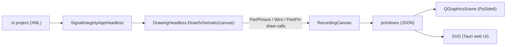

# GuiCore

`SignalIntegrity.GuiCore` is a small, toolkit-neutral layer used by the alternative user
interfaces (the PySide6 GUI in `SignalIntegrity/QtApp` and the Tauri GUI in
`SignalIntegrity/Server` + `Tauri/`). The tk application in `SignalIntegrity/App` does not
use it and is unchanged.

GuiCore only **adds** code. It does not change `SignalIntegrity.Lib`, `SignalIntegrity.App`,
or the `.si` project format. Scripts that use `SignalIntegrityAppHeadless`, `si.p.*` parsers,
`ProjectSParameters` and similar keep working exactly as before.

## Modules

| Module | Purpose |
|---|---|
| `RecordingCanvas.py` | Implements the six `tk.Canvas` calls the schematic code uses (`create_line`, `create_polygon`, `create_rectangle`, `create_oval`, `create_arc`, `create_text`) and records them as JSON-serializable dicts. |
| `Session.py` | `ProjectSession` is a façade over `SignalIntegrityAppHeadless`: it opens and saves projects, renders, selects and moves devices, edits properties, property visibility and variables, sets calculation properties, shows the netlist, runs calculations, and traverses the project hierarchy. |
| `Results.py` | `ResultData` keeps the original SignalIntegrity waveforms, s-parameters and eye-diagram images of a calculation or device view. It provides plot data (time, spectral content, spectral density) for any x range, with min/max decimation, and autoscale limits chosen the way the tk simulator dialog chooses them. |

## How rendering works

The part pictures in `PartPicture.py` (about 2,900 lines of procedural drawing code) are reused
as-is. `DrawingHeadless` already accepts any object with the `tk.Canvas` drawing API (the TikZ
exporter works the same way), so each new GUI only needs to turn about 6 primitive types into
its own toolkit.

### Primitive format

| type | fields |
|---|---|
| `line` | `points` [x0,y0,x1,y1,...], `color`, `width`, optional `arrow` (`first`/`last`/`both`), `arrowshape` [d1,d2,d3], `dash` |
| `polygon` | `points`, `outline`, `fill` |
| `rectangle`, `oval` | `bbox` [x0,y0,x1,y1], `outline`, `fill` |
| `arc` | `bbox`, `start`, `extent` (degrees, counter-clockwise, like tk), `outline` |
| `text` | `x`, `y`, `text`, `anchor` (tk anchor: `n`, `sw`, `center`, ...), `color` |

Coordinates are in the same pixel units the tk application uses (`grid` pixels per grid unit).

## ProjectSession API

| Method | Returns |
|---|---|
| `Open(filename)` | render dict (below); raises `SessionError` on failure |
| `Save(filename=None)` | the saved path (`.si` is appended if missing) |
| `Render()` | `{filename,title,path,readOnly,canAscend,grid,items,bbox,devices,capabilities,equationsValid}` |
| `DeviceAt(x,y)` / `Select(index)` | device index under a pixel point / select one device |
| `DeviceProperties(index)` / `SetDeviceProperty(index,keyword,value)` | list of `{keyword,name,description,type,unit,value,visible,keywordVisible,validEntries,readOnly}`; enum values are checked against `validEntries` |
| `SetDevicePropertyVisibility(index,keyword,visible=None,keywordVisible=None)` | chooses what is shown next to the part on the schematic (the tk properties dialog checkboxes) |
| `MoveDevice(index,dx,dy)` / `RotateDevice(index)` | move by whole grid units / rotate 90° |
| `Variables()` / `SetVariable(name,value)` / `SetVariableVisible(name,visible)` | list of `{name,value,type,units,description,visible,readOnly}` |
| `CalculationProperties()` / `SetCalculationProperties(dict)` | `EndFrequency`, `FrequencyPoints`, `UserSampleRate`, `ReferenceImpedance` |
| `NetList()` | netlist text |
| `Calculate(kind, callback=None)` | `kind` is one of `simulate`, `sparameters`, `virtualprobe`, `deembed`; returns `ResultData` |
| `ViewActions(index)` | the device's tk **View** menu actions: `file` (View an s-parameter file / Open Project for a `.si` file), `openproject` (a source's waveform project), `waveform` (View Waveform) |
| `View(index,action)` | `('project',render)` after descending, or `('result',ResultData)` |
| `Descend(index,filename)` / `Ascend()` | enters a sub-project read-only, passing the device variables (plus calculation properties when `calcprop` is true) exactly like the tk app's `LaunchProjectFile`; returns to the parent with its unsaved edits |

### ResultData

| Member | Returns |
|---|---|
| `waveforms`, `sparameters`, `eyes` | `(name, Waveform or float)`, `(name, SParameters)`, `(name, PIL image)` lists |
| `WaveformInfo()` | `[{index,name,dc,points,start,sampleRate}]` |
| `Arrays(i,view)` | full-resolution numpy `(x,y)` for `time`, `content` (dBm) or `density` (dBm/Hz) |
| `Series(view,indices,xmin,xmax,maxPoints)` | JSON plot data limited to an x range; min/max decimation keeps every peak visible |
| `AutoscaleLimits(view,indices)` | `[xmin,xmax,ymin,ymax]` as the tk dialog computes them (spectral views clip the floor at mean-½σ) |
| `Summary()` | JSON description with waveform info, s-parameter traces and eye images as PNG data URLs |

The waveform list matches the tk simulator dialog: output probes, other waveforms, sources
with `show` on, and waveform-processor sources, each once.

Every calculation runs through the same `SignalIntegrityAppHeadless` methods (`Simulate`,
`CalculateSParameters`, `VirtualProbe`, `Deembed`) that scripts and the regression tests use,
so results are numerically identical to the tk GUI. `TestGuiCore.testSimulateMatchesHeadless`
checks this to 12 decimal places.

If the progress callback returns `False`, the calculation is cancelled and `Calculate` raises
`SessionError`.

## Limits

- `ProjectSession` uses the process-global `SignalIntegrity.App.Project`, the same as the
  headless app. Use one session per process (or per worker process).
- Opening a project changes the working directory to the project's folder, matching the
  existing headless behaviour. Pass absolute paths.
- Sub-projects are read-only. Edit a sub-project by opening it directly.

## Tests

`Test/TestSignalIntegrity/TestGuiCore` (included in `TestAll.py`).
