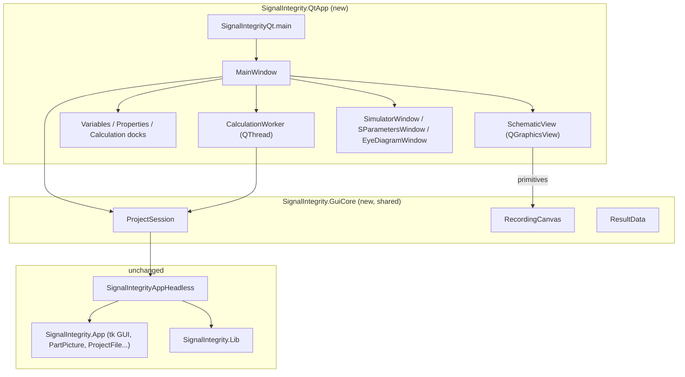

# SignalIntegrity Qt GUI (PySide6)

`SignalIntegrity.QtApp` is a PySide6 user interface for SignalIntegrity projects. It runs
alongside the existing tk application (`SignalIntegrity.App`) and doesn't replace it. Both
read and write the same `.si` files.

## Running

```bash
pip install SignalIntegrity[qt]        # or: pip install PySide6
SignalIntegrityQt [project.si]         # console script added to setup.py
python -m SignalIntegrity.QtApp [project.si]
```

The tk GUI is still started with `SignalIntegrity`. PySide6 is an optional extra, so a
standard install does not pull it in.

## What's included

| Area | Behaviour |
|---|---|
| Schematic | Every part picture, wire, pin, dot and label, drawn from the tk drawing code through `GuiCore.RecordingCanvas`. Wheel to zoom, drag the background to pan, Zoom to Fit. |
| Devices | Click to select (highlighted blue, as in tk). Drag to move on the grid. Rotate with Ctrl+R. Properties appear in the **Device Properties** dock and can be edited in place; values are validated, SI suffixes like `33 n` are accepted, `=variable` references work, and enum properties use a drop-down. |
| Show on schematic | As in the tk properties dialog, each property has a **Show** checkbox (`Visible`) and a **Keyword** checkbox (`KeywordVisible`) that choose what is drawn next to the part. Each variable has a **Show** checkbox too. The schematic updates immediately and the choices are saved in the project. |
| Hierarchy traversal | Right-click a device for its tk **View** actions: **Open Project** descends into a sub-project (`.si` file property) or a source's waveform project, **View** shows an s-parameter file, and **View Waveform** plots a source's waveform. Ctrl+right-click goes straight to the project, as in tk; Ctrl+E does the same for the selected device. The device's variables (and calculation properties when `calcprop` is true) are passed into the sub-project, as the tk app passes them on its command line. Sub-projects open read-only in the same window; the title shows the path (`PIDSimulation.si > PID.si (Read Only)`). **Up to Parent Project** (Alt+Up) returns with unsaved parent edits intact and the traversed device selected. |
| Variables | **Variables** dock with editable values (read-only variables are locked). |
| Calculation properties | End frequency, frequency points, user sample rate and reference impedance. |
| Calculate | Simulate, Calculate S-parameters, Virtual Probe and De-embed. Each is enabled only when the schematic supports it, using the same rules as tk. Runs on a worker thread with a cancellable progress dialog. |
| Simulator window | A port of the tk simulator dialog. It shows every waveform the tk dialog shows: probe outputs, other waveforms, sources with `show` on, and waveform-processor sources, each once, at full resolution (for example the 2,053,700-point waveforms of `PRBSTest.si`). DC results are drawn as horizontal lines. Includes the **Selection** menu (per-waveform plus All/None/Toggle, with stable colours), **View** (Show Grids, Time-domain, Spectral Content, Spectral Density, Log Frequency Scale), **File > Save Waveforms**, **Calculate > Recalculate**, and a status bar with points, start time and sample rate. Eye probes with `eyestate` on open eye-diagram windows. |
| Plot zoom | Same as the tk dialogs: the matplotlib toolbar **starts in pan mode** (left-drag pans; right-drag zooms x and y independently around the pointer), the magnifier tool gives box zoom, Home/Back/Forward keep a zoom history, and **autoscale** resets. The simulator window is reused for each recalculation, and its x/y limits are **kept across recalculations, waveform selection changes and Show Grids**, exactly like the tk dialog. They reset only on autoscale or when switching between time and frequency views. S-parameter windows use the same pan-first toolbar and autoscale. |
| Files | Open, Save, Save As (`.si`). Show Netlist. |

Not yet ported from the tk GUI: placing new parts and drawing wires, undo/redo, statistical
noise windows, post-processing and equations editors, the S-parameter viewer's
impulse/step/impedance views, TikZ/PNG export, archives (`.siz`), preferences, and the help
system. Use the tk GUI for these. Both GUIs share the same file format, so you can switch
between them freely.

## Architecture



| File | Role |
|---|---|
| `SignalIntegrityQt.py` | Entry point (`main`). Prints a clear message if PySide6 is missing. |
| `MainWindow.py` | Menus, toolbar, docks (with Show/Keyword checkboxes and enum drop-downs), file handling, selection/move/rotate, the device context menu, hierarchy navigation, and calculation orchestration (`CalculationWorker`). |
| `SchematicView.py` | `AddPrimitives()` turns GuiCore primitives into `QGraphicsScene` items (including tk-style arrowheads, arcs and anchored text); `SchematicView` adds zoom, pan, hit testing, drag and the right-click signal. |
| `SimulatorWindow.py` | `SimulatorWindow` (port of the tk `SimulatorDialog`: selection, time and spectral views, zoom retention, save), `SParametersWindow`, `EyeDiagramWindow`, and the shared pan-first `PlotPanel`. |

### Design decisions

- **No changes to existing code.** All GUI logic goes through `GuiCore.ProjectSession`,
  which only calls public `SignalIntegrityAppHeadless` methods. The existing tk app,
  headless API, library and project format are untouched, so existing clients behave
  exactly the same.
- **Part pictures are reused, not redrawn.** The tk drawing code writes to a recording
  canvas, so new or changed parts show up in the Qt GUI automatically.
- **Calculations run off the GUI thread.** The engine uses a process-global project, so the
  window disables editing and calculation actions while a calculation is running.

## Changes in this PR

- New packages: `SignalIntegrity/GuiCore` (shared with the Tauri PR, identical files) and
  `SignalIntegrity/QtApp`.
- `setup.py`: new optional extra `qt` (`PySide6>=6.5`) and console script `SignalIntegrityQt`.
  Existing requirements and entry points are unchanged.
- Tests: `Test/TestSignalIntegrity/TestGuiCore` and `Test/TestSignalIntegrity/TestQtApp`, both
  registered in `TestAll.py`. The Qt tests run with `QT_QPA_PLATFORM=offscreen` and are
  skipped when PySide6 isn't installed.

## Tests

```bash
python -m pytest Test/TestSignalIntegrity/TestGuiCore/TestGuiCore.py Test/TestSignalIntegrity/TestQtApp/TestQtApp.py
```
