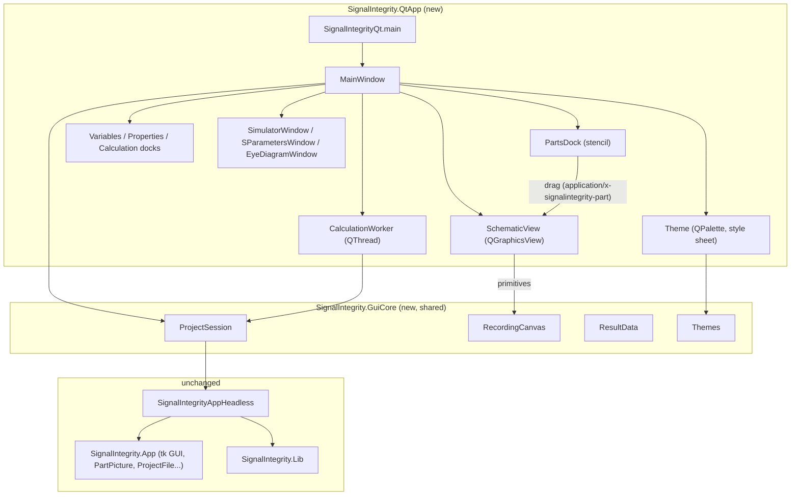

# SignalIntegrity Qt GUI (PySide6)

`SignalIntegrity.QtApp` is a PySide6 user interface for SignalIntegrity projects. It runs
alongside the existing tk application (`SignalIntegrity.App`) and doesn't replace it. Both
read and write the same `.si` files.

## Running

```bash
pip install SignalIntegrity[qt]        # or: pip install PySide6
SignalIntegrityQt [project.si]         # console script added to setup.py
python -m SignalIntegrity.QtApp [project.si]
```

From a source checkout, use a virtual environment so nothing is installed into the global
Python (`.venv/` is ignored by git, and `.vscode/settings.json` selects it):

```powershell
python -m venv .venv
.venv\Scripts\python -m pip install -e .[qt,test]
.venv\Scripts\python -m SignalIntegrity.QtApp SignalIntegrity\App\Examples\PID\PIDSimulation.si
```

The tk GUI is still started with `SignalIntegrity`. PySide6 is an optional extra, so a
standard install does not pull it in.

In VS Code, select **SignalIntegrity (PySide6)** under
Run and Debug and press F5. Both use the selected Python interpreter; the PySide6
configuration requires the `qt` extra in that environment.
On Windows with Tk 9, the existing tk application can fail during menu initialization.

## What's included

| Area | Behaviour |
|---|---|
| Schematic | Every part picture, wire, pin, dot and label, drawn from the tk drawing code through `GuiCore.RecordingCanvas`. Wheel to zoom, drag the background to pan, Zoom to Fit. |
| Menus and toolbar | Dropdown menus laid out like the tk app (**File, Edit, Parts, Wires, View, Calculate, Variables, Help**) with icons and shortcuts, and a toolbar of 24-pixel icons with captions. Both come from `GuiCore.Menus`/`GuiCore.Icons`, so the web GUI has the same commands. Unavailable commands are greyed out. |
| Wires | **Wires > Add Wire** (W, or the Wire toolbar button) enters wire mode, as in tk: click each corner (points snap to the grid, a dashed line follows the pointer), then double-click, right-click or press Enter to finish; keep clicking to draw the next wire, and press Esc to drop an unfinished wire or, again, to leave wire mode. Wires are consolidated the way the tk app does it (split at junctions, dots drawn where three or more meet). Click a wire to select it (blue, with its vertices marked) and press Delete or use **Wires > Delete Wire**. Drag a vertex to move it; **Wires > Delete Vertex** and **Duplicate Vertex** (then drag the copy) edit the selected vertex, as in tk. |
| Editing | **Undo**/**Redo** (Ctrl+Z, Ctrl+Shift+Z, up to 100 steps, labelled with the edit they undo), **Cut**/**Copy**/**Paste**/**Duplicate** parts (pasted parts get new reference designators), and **Parts > Flip Horizontally/Vertically**. |
| Equations and post-processing | **Variables > Schematic Equations** and **Calculate > Post-Processing** open text editors; equations are checked as you type and Help opens the online help. |
| Archives and export | **File > Archive Project** writes a `.siz` with every file the project uses; **Extract Archived Project** unpacks and opens one. **Export NetList**, **Export LaTeX (TikZ)** (`.TpX` or `.tex`) and **Export Bitmap Image** (PNG/JPEG) save the schematic. |
| Preferences and help | **Help > Preferences** edits the tk preferences file (one tab per section). **Open Help** (F1) and **Software Documentation** open the online help. |
| Recent projects | **File > Open Recent Projects** lists the last ten projects opened, created or saved under a new name in either alternative GUI (missing files are skipped), with **Clear Recent Projects**. |
| Parts stencil | The **Parts** dock lists all 144 parts of the tk **Add Part** picker, grouped by function (Resistors, Sources, Generators, Amplifiers, Transmission Lines, Ports and Probes...), each with a thumbnail of its part picture. Type in the search box to filter (every word must match the name, description or group). **Drag** a part onto the schematic, or **double-click** it (or press Enter) and then click where it goes; Esc cancels. New parts snap to the grid and get the next free reference designator (`R1`, `R2`...) and port number, as in tk. **Delete** (or Edit > Delete Selected) removes the selected part. |
| New projects | **File > New Project** (Ctrl+N) asks for a file name and starts an empty schematic, as the tk app does. |
| Themes | **View > Theme** lists the built-in SignalIntegrity Light and Dark themes and every color theme installed in VS Code (and Insiders, VSCodium, Cursor, Windsurf), split into dark and light. **Load Theme File...** opens any VS Code theme `.json` or `.vsix` package downloaded from the Marketplace or Open VSX. The theme restyles the window, docks, schematic, stencil thumbnails and plots (background, axes, grid and trace colors) and is remembered between runs. |
| Devices | Click to select (highlighted blue, as in tk). Drag to move on the grid. Rotate with Ctrl+R. Properties appear in the **Device Properties** dock and can be edited in place; values are validated, SI suffixes like `33 n` are accepted, `=variable` references work, and enum properties use a drop-down. |
| Show on schematic | As in the tk properties dialog, each property has a **Show** checkbox (`Visible`) and a **Keyword** checkbox (`KeywordVisible`) that choose what is drawn next to the part. Each variable has a **Show** checkbox too. The schematic updates immediately and the choices are saved in the project. |
| Hierarchy traversal | Right-click a device for its tk **View** actions: **Open Project** descends into a sub-project (`.si` file property) or a source's waveform project, **View** shows an s-parameter file, and **View Waveform** plots a source's waveform. Ctrl+right-click goes straight to the project, as in tk; Ctrl+E does the same for the selected device. The device's variables (and calculation properties when `calcprop` is true) are passed into the sub-project, as the tk app passes them on its command line. Sub-projects open read-only in the same window; the title shows the path (`PIDSimulation.si > PID.si (Read Only)`). **Up to Parent Project** (Alt+Up) returns with unsaved parent edits intact and the traversed device selected. |
| Variables | **Variables** dock with editable values (read-only variables are locked). |
| Calculation properties | End frequency, frequency points, user sample rate and reference impedance. |
| Calculate | Simulate, Calculate S-parameters, Virtual Probe and De-embed. Each is enabled only when the schematic supports it, using the same rules as tk. Runs on a worker thread with a cancellable progress dialog. |
| Simulator window | A port of the tk simulator dialog. It shows every waveform the tk dialog shows: probe outputs, other waveforms, sources with `show` on, and waveform-processor sources, each once, at full resolution (for example the 2,053,700-point waveforms of `PRBSTest.si`). DC results are drawn as horizontal lines. Includes the **Selection** menu (per-waveform plus All/None/Toggle, with stable colours), **View** (Show Grids, Time-domain, Spectral Content, Spectral Density, Log Frequency Scale), **File > Save Waveforms**, **Calculate > Recalculate**, and a status bar with points, start time and sample rate. Eye probes with `eyestate` on open eye-diagram windows. |
| Plot zoom | Same as the tk dialogs: the matplotlib toolbar **starts in pan mode** (left-drag pans; right-drag zooms x and y independently around the pointer), the magnifier tool gives box zoom, Home/Back/Forward keep a zoom history, and **autoscale** resets. The simulator window is reused for each recalculation, and its x/y limits are **kept across recalculations, waveform selection changes and Show Grids**, exactly like the tk dialog. They reset only on autoscale or when switching between time and frequency views. S-parameter windows use the same pan-first toolbar and autoscale, and add **impulse**, **step** and **impedance** tabs like the tk s-parameter viewer. Projects with statistical noise sources open a **Statistical Noise** window with the output noise densities and a measurements table (rms, dBm, densities, SNR, Salz SNR and per-source contributions). |
| Files | Open, Save, Save As (`.si`). Show Netlist. |

The tk GUI still has a few things these GUIs do not: bathtub curves, the eye-diagram and
statistical-noise property dialogs, the regression tools and the script editor. Both GUIs share
the same file format, so you can switch between them freely.

To extend this GUI, see [RECIPES.md](RECIPES.md) and [../GuiCore/RECIPES.md](../GuiCore/RECIPES.md).

## Architecture



| File | Role |
|---|---|
| `SignalIntegrityQt.py` | Entry point (`main`). Prints a clear message if PySide6 is missing. |
| `MainWindow.py` | Menus, toolbar, docks (with Show/Keyword checkboxes and enum drop-downs), file handling, selection/move/rotate, the device context menu, hierarchy navigation, and calculation orchestration (`CalculationWorker`). |
| `SchematicView.py` | `AddPrimitives()` turns GuiCore primitives into `QGraphicsScene` items (including tk-style arrowheads, arcs and anchored text), recolored through the theme's color map; `SchematicView` adds zoom, pan, hit testing, drag, part drops, click-to-place, Delete and the right-click signal. |
| `PartsDock.py` | The parts stencil: a searchable, grouped `QTreeWidget` with part-picture thumbnails that drags parts as `application/x-signalintegrity-part`. |
| `Theme.py` | Applies a GuiCore palette to the application (Fusion style, `QPalette`, style sheet) and to matplotlib axes; provides the app icon. |
| `icons/` | `SignalIntegrityQt.png`/`.ico` (an eye diagram glowing on a teal tile) and `MakeIcons.py`, which renders the Qt and Tauri icons (`python MakeIcons.py <folder> qt\|tauri`, needs Pillow and numpy). |
| `SimulatorWindow.py` | `SimulatorWindow` (port of the tk `SimulatorDialog`: selection, time and spectral views, zoom retention, save), `SParametersWindow`, `EyeDiagramWindow`, and the shared pan-first `PlotPanel`. |

### Design decisions

- **No changes to existing code.** All GUI logic goes through `GuiCore.ProjectSession`,
  which only calls public `SignalIntegrityAppHeadless` methods. The existing tk app,
  headless API, library and project format are untouched, so existing clients behave
  exactly the same.
- **Part pictures are reused, not redrawn.** The tk drawing code writes to a recording
  canvas, so new or changed parts show up in the Qt GUI automatically.
- **Calculations run off the GUI thread.** The engine uses a process-global project, so the
  window disables editing and calculation actions while a calculation is running.

## Changes in this PR

- New packages: `SignalIntegrity/GuiCore` (shared with the Tauri PR, identical files) and
  `SignalIntegrity/QtApp`.
- `setup.py`: new optional extra `qt` (`PySide6>=6.5`), console script `SignalIntegrityQt`,
  and `package_data` for the Qt icons. Existing requirements and entry points are unchanged.
- Tests: `Test/TestSignalIntegrity/TestGuiCore` and `Test/TestSignalIntegrity/TestQtApp`, both
  registered in `TestAll.py`. The Qt tests run with `QT_QPA_PLATFORM=offscreen` and are
  skipped when PySide6 isn't installed.

## Tests

```bash
python -m pytest Test/TestSignalIntegrity/TestGuiCore/TestGuiCore.py Test/TestSignalIntegrity/TestQtApp/TestQtApp.py
```
