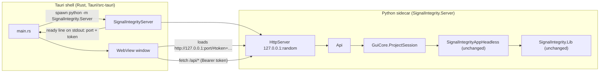

# SignalIntegrity desktop app (Tauri)

A native desktop window for SignalIntegrity built with [Tauri 2](https://tauri.app). The shell
is a small Rust program that starts the SignalIntegrity Python engine as a sidecar process and
shows its web GUI in the system WebView (WebView2 on Windows, WKWebView on macOS, WebKitGTK on
Linux).

It runs alongside the existing GUIs; it doesn't replace them:

| GUI | Start with | Notes |
|---|---|---|
| tk (original, full featured) | `SignalIntegrity` | unchanged |
| Web / Tauri (this PR) | `SignalIntegrityServer --browser` or the Tauri app | same `.si` files |

## Architecture



Startup sequence:

1. Tauri opens the main window on a bundled loading page (`Tauri/loading`).
2. `main.rs` looks for a Python interpreter (`$SIGNALINTEGRITY_PYTHON`, then the checkout's
   `.venv`, then `python`, `python3`, `py -3`) and runs `python -m SignalIntegrity.Server [project.si]`
   with its stdout piped and no console window.
3. The server binds a random free port on `127.0.0.1`, creates a random access token, and
   prints one JSON ready line. Only the parent process can see it.
4. The shell navigates the window to `http://127.0.0.1:<port>/#token=<token>`. From then on,
   the UI talks to the server only through the token-protected JSON API (see
   [`SignalIntegrity/Server/README.md`](../SignalIntegrity/Server/README.md)).
5. When the app exits, the sidecar is killed.

If Python or SignalIntegrity can't be found, the loading page shows the error and how to fix
it.

### Why a Python sidecar instead of rewriting the engine?

All of the numerical code, netlist generation and part pictures already exist in Python.
Running them out-of-process keeps a single source of truth: results are identical to the tk
GUI and the headless API, and every new part or feature automatically shows up in the
schematic. The shell has no Tauri IPC commands; the WebView only talks to the local server.
That keeps the attack surface small and lets the same UI run in a normal browser.

### Development builds

Debug and release builds made from this repository put the checkout on `PYTHONPATH`, using
the path compiled in from `CARGO_MANIFEST_DIR` or `$SIGNALINTEGRITY_ROOT`, and start the
server from the repository root. The app therefore always runs the code in your working
tree, even if a different SignalIntegrity version is installed with pip. Installed apps
without a checkout use whatever `SignalIntegrity` the chosen interpreter imports.

## Building

Prerequisites: Rust (stable, MSVC toolchain on Windows), Node.js 18+ (only for the Tauri CLI
and bundling), Python 3 with SignalIntegrity's requirements. Windows also needs the WebView2
runtime, which is preinstalled on Windows 10/11.

Keep the Python requirements out of the global installation with a virtual environment in
the checkout. The shell finds `.venv` automatically, `.venv/` is ignored by git, and
`.vscode/settings.json` selects it:

```powershell
python -m venv .venv
.venv\Scripts\python -m pip install -e .[test]
.venv\Scripts\python -m SignalIntegrity.Server --browser   # browser-only, without Rust
```

```bash
cd Tauri
npm install                 # installs @tauri-apps/cli locally
npm run tauri dev           # run in development
npm run tauri build         # installers in src-tauri/target/release/bundle
# or, without Node:
cd src-tauri && cargo build --release
```

Run a project directly: `signalintegrity-desktop path/to/project.si`. Set
`SIGNALINTEGRITY_PYTHON` to choose the interpreter.

Icons in `src-tauri/icons` were generated with `npx tauri icon app-icon.png`. `app-icon.png`
(an eye diagram glowing amber on a violet tile) and `../SignalIntegrity/Server/ui/favicon.png`
are rendered by `MakeIcons.py` (`python MakeIcons.py <folder> tauri`, needs Pillow and numpy).

The window sets `dragDropEnabled: false` in `tauri.conf.json`. On Windows, Tauri's native
file-drop handler otherwise swallows HTML5 drag-and-drop, which the parts stencil uses.

## Features

Same scope as the PySide6 GUI. Both are built on `SignalIntegrity.GuiCore`:

- Schematic rendered from the original part pictures as SVG. Wheel to zoom, drag to pan, Fit.
- **Parts stencil:** all 144 parts of the tk Add Part picker in collapsible groups (Resistors,
  Sources, Generators, Amplifiers, Ports and Probes...) with thumbnails and search. Drag a part
  onto the schematic, or click it and then click where it goes (Esc cancels). Parts snap to the
  grid and get the next reference designator and port number. Delete removes the selection.
- **New** (Ctrl+N) creates an empty project, as tk's File > New Project does.
- **Themes:** the Theme menu lists SignalIntegrity Light/Dark and every color theme installed
  in VS Code (and Insiders, VSCodium, Cursor, Windsurf). **Load Theme File...** accepts a VS Code
  theme `.json` or a `.vsix` downloaded from the Marketplace or Open VSX. The theme colors the
  UI, the schematic, the stencil and the plots, and is shared with the Qt GUI.
- Click to select a device (highlighted blue), drag to move it on the grid, Ctrl+R to rotate.
- Edit device properties (enums as drop-downs), project variables and calculation properties in place.
- **Show on schematic:** Show/Kw checkboxes per property and Show per variable. These are the
  tk properties dialog's `Visible`/`KeywordVisible` choices, and they redraw immediately.
- **Hierarchy traversal:** right-click a device for its tk View actions: Open Project into a `.si`
  file or a source's waveform project, View an s-parameter file, or View Waveform. Ctrl+right-click
  (or Ctrl+E) opens the project directly. The device's variables and calculation properties are
  passed in, as the tk app does. Sub-projects are read-only, a path bar shows where you are, and
  Up (Alt+Up) returns to the parent with its unsaved edits.
- Simulate, S-parameters, Virtual Probe and De-embed, each enabled only when the schematic
  supports it. Runs as a background job with progress and Cancel.
- **Simulator dialog (port of the tk one):** shows every waveform the tk dialog shows, at full
  resolution through ranged, decimated data requests. It has per-waveform selection with
  All/None/Toggle, Time-domain, Spectral Content and Spectral Density views, log frequency
  scale, grids, Recalculate, a status line with points and sample rate, and an x/y cursor
  readout. It also has tabs for **eye diagrams** and s-parameter magnitude/phase.
- **Plot zoom like the tk dialogs:** pan mode by default (left-drag pans, right-drag zooms each
  axis about the pointer), zoom-box mode, Home/Back/Forward, and autoscale. The zoom and
  selections are **kept across recalculations**, as in the tk simulator dialog.
- Open, Save, Save As (built-in file browser), Netlist viewer, keyboard shortcuts.

Not yet ported (use the tk GUI): drawing wires, copy/paste, flipping parts, undo/redo,
statistical noise windows, the equations and post-processing editors, `.siz` archives,
preferences, and help. Parts placed here can be wired in the tk GUI; both use the same files.

## Changes in this PR

- `SignalIntegrity/GuiCore`: toolkit-neutral session and recording canvas, shared with the
  PySide6 PR (identical files).
- `SignalIntegrity/Server`: standard-library HTTP/JSON server and the web UI (`ui/`).
- `Tauri/`: Tauri 2 shell (`src-tauri`), loading page, icons, `package.json` for the CLI.
- `setup.py`: new console script `SignalIntegrityServer` and `package_data` for the web UI.
  Existing requirements and entry points are unchanged.
- Tests: `Test/TestSignalIntegrity/TestGuiCore` and `Test/TestSignalIntegrity/TestServer`,
  registered in `TestAll.py`.

## Validation performed

- Unit and HTTP tests (above).
- Browser end-to-end check of the web UI with the bundled examples: render, select, property
  edit, S-parameters (`telegrapherFourPort.si`), open dialog, and simulate (`RLC.si`).
- Browser check of the stencil and themes: HTML5 drag-and-drop of a resistor, click-to-place
  of a capacitor (references R2/C2 after the existing R1/C1), Delete, switching to VS Code's
  Dark Modern theme (UI, schematic, thumbnails and plot traces recolored), and simulate.
- `cargo build` of the shell on Windows (MSVC, WebView2). The app was launched with
  `RLC.si`: the sidecar started, the schematic rendered, and the sidecar was terminated when
  the window closed.
